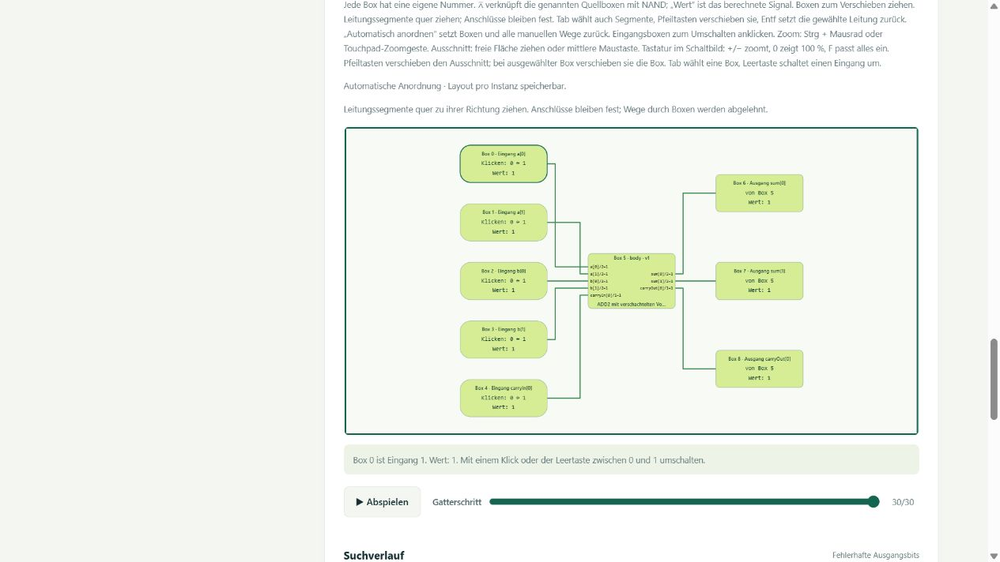

# Wiederverwendbare Unterprogramm-Bausteine (PRIM-05)

Ein Baustein besitzt einen Namen, eine positive Versionsnummer, eine feste
Definitionskennung, benannte Ein-/Ausgangsports und eine konkrete NAND-Implementierung.
Er kann andere Bausteine enthalten; diese dürfen wiederum Unterbausteine enthalten.
Mehrere Instanzen derselben Definition haben getrennte Eingangszuordnungen.
Alle Funktionen sind kombinatorisch und ohne verborgenen Zustand.

## Bedienung

1. Eine vorhandene Schaltung öffnen und unter **Unterprogramm-Bausteine** einen
   Namen eingeben. **Geöffnete Schaltung als Baustein speichern** übernimmt die
   konkrete Implementierung und vorhandene Portnamen. Ohne benannte Schnittstelle
   entstehen Ein-Bit-Ports in0…, out0… . Auch eine bereits hierarchische Schaltung
   behält beim erneuten Speichern ihre Unterbausteine.
2. **Als Unterbaustein einsetzen** bereitet eine neue übergeordnete Definition
   mit einer Instanz im JSON-Editor vor. **Zweimal einsetzen** bereitet zwei
   unabhängige Instanzen mit eigenen Ports vor. Weitere Instanzen und Verbindungen
   können im Entwurf ergänzt werden. Die Schaltflächen setzen die Definition
   zunächst in den Editor; **Bausteindefinition prüfen & speichern** übernimmt sie.
3. In `nodes[].inputs` stehen die benannten Eingangsports jeder Instanz. Jede
   Bitliste muss genau die zugehörige Portbreite haben. Ein Bit darf von einem
   Eingang des Elternbausteins oder einem Ausgang eines anderen Knotens kommen.
   Mehrere Ziele dürfen dieselbe Quelle lesen. Die Reihenfolge der Listen ist LSB-first.
4. **Baustein öffnen** erzeugt die gewählte Anzahl Vektoren und öffnet seine
   interne Schaltung mit klickbaren Unterprogramm-Boxen. Die Hierarchieliste zeigt
   Namen, Instanzpfade, Versionen und Schnittstellen aller Unterbausteine.
   Eingänge, Simulation und Layout bleiben wie bisher bedienbar.
5. **Bausteinpaket exportieren** enthält die Wurzel und alle Abhängigkeiten.
   Das Paket kann in einer leeren Bibliothek unter **Bausteinpaket importieren**
   geladen werden. Auch der JSON-Programmexport einer geöffneten Hierarchie enthält
   die Hierarchie, NAND-Expansion und die zugehörigen Vektoren.

Unter **Aufgabendefinition → Gespeicherte Bausteinreferenz** können weitere
Stichproben der geöffneten Referenz erzeugt werden. Diese beschreiben die konkrete
Bausteinfunktion. Wird ein Annäherungsprogramm gespeichert, behauptet sein Baustein
keine plötzlich korrekte Arithmetikoperation: Er führt dieselbe gespeicherte
Schaltung aus. Eine reine Operationsvorlage ohne NAND-Implementierung ist noch
kein verdrahteter Baustein.

## Unterprogramm-Boxen und lokales Debugging (PRIM-06)

Jede direkte Instanz erscheint als eigene Box mit Instanzname, Versionsnummer,
Bausteinname und benannten Ein-/Ausgangsbits. Die Beschriftung `a[0]/2=1`
bedeutet: Bit 0 des zweibittigen Ports a hat den Wert 1. Leitungen treffen die
zugehörigen Bitanschlüsse in fester Portreihenfolge. Lange Namen werden in der
Box verkürzt und im Tooltip vollständig angezeigt. Die Boxhöhe wächst mit der
Anzahl der Anschlüsse. Boxen und Leitungswege lassen sich verschieben und zoomen.
Zum Verbinden weiterhin **Als Unterbaustein einsetzen** bzw. **Zweimal einsetzen**
und den benannten JSON-Porteditor verwenden, danach prüfen, speichern und öffnen.

**Klick oder Enter** auf eine Unterprogramm-Box öffnet ihre interne Schaltung.
Der Pfad im Debugger identifiziert die konkrete Instanz. Deren anfängliche
Testeingänge werden aus der vollständigen Auswertung der übergeordneten Schaltung
übernommen; diese Übernahme ist unabhängig von deren Animationsschritt.
Weitere Unterprogramm-Boxen können bis zu den internen NAND-Gattern geöffnet werden.

Die Eingänge sind über Bits oder Zahlenfelder veränderbar. Zahlen folgen der
unsigned-/Zweierkomplement-Semantik des Ports; ungültige oder zu grosse Werte
werden mit einer Bereichsmeldung abgelehnt. Ergebnisse zeigen Zahlenwerte und
LSB-first-Bits. Beispielsweise liefert der Zweibit-Addierer bei a=3, b=3 und
carryIn=1 den Wert sum=3 und carryOut=1, also insgesamt 7. Mit allen Eingängen
auf 0 entstehen sum=0 und carryOut=0. Der Übertrag ist Teil der tatsächlichen
NAND-Funktion; Portmetadaten fügen keine zusätzlichen Fehlerbedingungen hinzu.

**Test zurücksetzen** stellt die beim Öffnen übernommenen Testeingänge und
Gatterschritt 0 her. **Nächstes NAND-Gatter**, der Schieberegler und **Abspielen**
zeigen interne Signale schrittweise; noch nicht berechnete Signale erscheinen
als `·`. **Vollständig auswerten** zeigt sämtliche Ergebnisse. Es handelt sich
um Schritte der NAND-Expansion, auch wenn mehrere Gatter in einer sichtbaren
Unterprogramm-Box zusammengefasst sind.

**Zur übergeordneten Schaltung** verwirft die lokalen Handwerte und stellt deren
tatsächliche Eingänge, Gatterschritt, Auswahl, Zoom und Layout wieder her.
Handtests ändern keine andere Instanz und keine gespeicherte Definition.
Die Vektortabelle prüft weiterhin die Gesamtschaltung; Zeilen sind während eines
lokalen Handtests nicht zum Laden in den Debugger aktiv.

**Layout speichern** sichert Boxpositionen und manuelle Leitungswege unter der
festen Paketkennung und dem vollständigen Instanzpfad. Zwei Instanzen derselben
Definition erhalten unterschiedliche Layouts. Diese überstehen Neuladen und
Serverneustart. Beim Navigieren innerhalb eines geöffneten Pakets bleiben auch
ungespeicherte Layouts und Kameras im Speicher erhalten. Erneutes Öffnen beginnt
bei der Wurzel; lokale Handwerte und der Navigationspfad werden nicht dauerhaft
gespeichert. Flache Schaltungen behalten ihre bisherigen Layoutdateien.

Reine Operationsvorlagen ohne NAND-Implementierung bleiben unter **Definierte
Funktionen** mit „keine Schaltung“ gekennzeichnet. Der Baustein-Debugger arbeitet
ausschliesslich mit den konkreten gespeicherten NAND-Implementierungen.



## Verschachtelte Beispiele

Die drei Dateien in [`examples/blocks/`](../examples/blocks/) sind eigenständige
Pakete mit allen Abhängigkeiten. Ihre NAND-Implementierungen sind ausdrücklich
konstruierte Beispiele; sie werden nicht als evolutionär gefunden ausgegeben.

| Paket | Aufbau | Ein-/Ausgangsbits | NAND-Gatter | Vollständige Tabelle |
|---|---|---:|---:|---:|
| half-adder.json | XOR und AND als Unterbausteine | 2:2 | 6 | 4 Zeilen |
| full-adder.json | Zwei verbundene Halbaddierer und OR | 3:2 | 15 | 8 Zeilen |
| ripple-adder-2.json | Zwei verbundene Volladdierer; darunter Halbaddierer und Logikbausteine | 5:3 | 30 | 32 Zeilen |

Im Zweibit-Addierer haben a und b je zwei Bits, carryIn ein Bit. Das Ergebnis
besteht aus sum mit zwei Bits und carryOut mit einem Bit. Der Übertrag der
unteren Volladdierer-Instanz speist die obere Instanz. Beide verwenden dieselbe
feste Volladdiererdefinition. Alle 32 Kombinationen werden gegen a+b+carryIn
und zusätzlich über die unabhängig ausgewertete Hierarchie und NAND-Expansion geprüft.

```powershell
python tools/export_blocks.py
python -m primitives blocks import examples/blocks/ripple-adder-2.json
python -m primitives blocks list
python -m primitives blocks eval examples/blocks/ripple-adder-2.json 11111
python -m primitives blocks expand examples/blocks/ripple-adder-2.json --out expanded.json
python -m primitives blocks vectors examples/blocks/ripple-adder-2.json --samples 32 --out vectors.json
```

`11111` bedeutet a=3, b=3, carryIn=1; das LSB-first-Ergebnis ist `[1,1,1]`, also 7.
Eine gespeicherte Schaltung lässt sich mit
`python -m primitives blocks from-program PROGRAMM_ID --name MeinBaustein --version 1 --out block.json`
übernehmen. `--interface ports.json` ersetzt dabei bei Bedarf die Portgruppierung.
`python -m primitives blocks compose definition.json --dependency BLOCK_ID --out parent.json`
speichert eine neue Definition mit einer vorhandenen Abhängigkeit; die Option
`--dependency` ist wiederholbar. Es werden nur explizit importierte/erstellte
Wurzelbausteine als Bibliothekseinträge angezeigt. Ihre eingebetteten Abhängigkeiten
benötigen keine separaten Bibliotheksdateien.

## Format und Versionsbindung

Das Paket hat die Form `{"schema":1,"root":"block-…","definitions":{…}}`.
Jeder Definitionsschlüssel ist `block-` plus vollständiger SHA-256-Fingerabdruck
des normalisierten Definitionsinhalts. Gehasht wird JSON mit sortierten Schlüsseln,
ASCII-Escapes und ohne zusätzliche Leerzeichen (`separators=(",",":")`).
Die Definition enthält `name`, `version`, `interface` und entweder eine flache
`circuit` oder `nodes` mit `outputs`. Optional dokumentiert `source_program` die
konkrete übernommene Programmkennung. Portnamen, Breiten, Vorzeichen und Offsets
folgen [FORMAT.md](FORMAT.md#benannte-ports-und-breitenvarianten).
Verbindungen übertragen exakt die angegebenen Bits; es gibt keine automatische
Vorzeichen- oder Nullerweiterung zwischen unterschiedlich breiten Ports.
Vorzeichen und Überlaufattribute beschreiben die benannte Zahlenschnittstelle.
Die fest gespeicherte NAND-Implementierung bestimmt ihre tatsächliche Rechenfunktion.

Eine neue flache Definition kann ohne manuelle Hashberechnung per
`POST /api/blocks` oder im Browsereditor angelegt werden:

```json
{
  "definition": {
    "name": "NAND", "version": 1,
    "interface": {
      "inputs": [{"name":"a","bits":1},{"name":"b","bits":1}],
      "outputs": [{"name":"value","bits":1}]
    },
    "circuit": {"inputs":2,"gates":[[0,1]],"outputs":[2]}
  }
}
```

In einer übergeordneten Definition sehen Instanzen und Bitquellen so aus:

```json
{
  "id": "second", "type": "instance", "definition": "block-VOLLSTAENDIGE_KENNUNG",
  "inputs": {
    "a": [{"node":"first","port":"sum","bit":0}],
    "b": [{"input":"carryIn","bit":0}]
  }
}
```

`outputs` des Elternbausteins ordnet jedem eigenen Ausgangsport eine gleich breite
Liste solcher Bitquellen zu. Zusätzlich sind lokale NAND-Knoten mit `type:"nand"`,
zwei Bitquellen in `inputs` und dem Ein-Bit-Ausgang `out` möglich. Die Knotenliste
darf von der Auswertungsreihenfolge abweichen; die Prüfung berechnet eine
topologische Reihenfolge. Unbekannte Ports, unpassende Bitbreiten, fehlende
Definitionen, rekursive Definitionsketten und zyklische Signalverbindungen
werden vor dem Speichern abgelehnt.

Eine Änderung der Schnittstelle, Implementierung, Version, Herkunft oder
Abhängigkeit erzeugt eine neue Inhaltskennung. Die Versionsnummer kann im
Definitionsentwurf ausdrücklich erhöht werden; eine vorhandene Kennung wird
nicht ersetzt. Für Änderungen **Als Unterbaustein einsetzen** verwenden oder
einen neuen `definition`-Entwurf anlegen. Ein exportiertes Paket trägt bereits
geprüfte Kennungen; direkt geänderte Inhalte mit alten Kennungen werden abgelehnt.
Eine später bessere Bibliotheksschaltung ändert existierende Instanzen nicht.

## Auswertung, Evolution und Grenzen

`BlockBundle.evaluate` führt die benannten Instanzen rekursiv und unabhängig
aus. `expand` ersetzt jede Instanz durch ihre konkrete NAND-Gatterliste, mit
frischen internen Drähten pro Instanz. Gemeinsame Definitionen bedeuten keinen
gemeinsamen Signalzustand. Beim Speichern/Laden eines Programms mit `hierarchy`
muss dessen `circuit` exakt dieser Expansion entsprechen. Datensätze können
das Paket als `metadata.hierarchy` mit der passenden Schnittstelle führen.

Gespeicherte Bausteine werden für beide Suchbackends expandiert als mögliche
Startbausteine angeboten. Die Genom-Gatter bleiben mutierbar. Suchergebnisse
geben daher eine flache NAND-Schaltung zurück; sie beanspruchen keine erhaltenen
Originalinstanzen. `search.seed_blocks` nennt die angebotenen festen Kennungen.
`search.ancestry` protokolliert dagegen tatsächliche
Bibliothekskompositionen mit festen Kennungen, NAND-Schnappschüssen und
Eingangsverdrahtung sowie deren Kandidaten-Nachkommen. Dies behauptet weiterhin
keinen unveränderten Erhalt der Originalinstanzen. Eine Restfallkorrektur entfernt
ebenfalls die Hierarchiebehauptung, sobald sie die NAND-Implementierung verändert.
Die unveränderlichen Bausteine und Referenzmetadaten bleiben erhalten.

Pro Schnittstellenseite gelten weiterhin 1–128 Gesamtbits. Ein Paket enthält
höchstens 128 Definitionen, eine Definition höchstens 512 direkte Knoten.
Maximal 32 Verschachtelungsschritte und 2048 expandierte Hierarchie-/Knotenobjekte
verhindern auch eine unbeschränkte Vermehrung gatterloser Unterbausteine.
Die gesamte Expansion darf höchstens 512 NAND-Gatter enthalten. Für die Evolution
gelten zusätzlich das eingestellte Gatterbudget und deren bestehende Limits.
Vektoren bleiben auf 65536 Zeilen begrenzt; eine Stichprobe wird als solche ausgewiesen.

API: `GET /api/catalog` enthält `blocks`, `GET /api/blocks/ID` das portable Paket.
`POST /api/blocks` akzeptiert ein Paket, eine neue `definition` mit einer Liste
lokaler `dependencies` oder `program_id` mit optionalen Name-/Port-/Versionsangaben.
`POST /api/blocks/evaluate` erhält `block_id` oder `block` und `bits`.
`POST /api/blocks/expand` erhält `block_id` oder `block`.
`POST /api/blocks/view` erhält `block_id` oder `block` sowie einen optionalen
`path`, z. B. `["low", "first", "sum"]`. Die Antwort enthält Definition, Name,
Version, Schnittstelle und `circuit`. Bei Hierarchien enthält `circuit.view_nodes`
die sichtbaren Boxen mit `signalRefs`, `inputRefs` und `sourceBits`, die auf die
exakten Signale der lokalen NAND-Expansion verweisen. Die gespeicherte Definition
bleibt unverändert. `POST /api/blocks/layout/load` und `/api/blocks/layout/save`
verwenden dieselbe Paket-/Pfadauswahl; Speichern benötigt `positions` und `wires`.
Boxanzahl und Leitungskennungen werden aus dem geprüften Paket abgeleitet.
`POST /api/datasets` mit `block`, `samples` und `seed` erzeugt Referenzvektoren.


