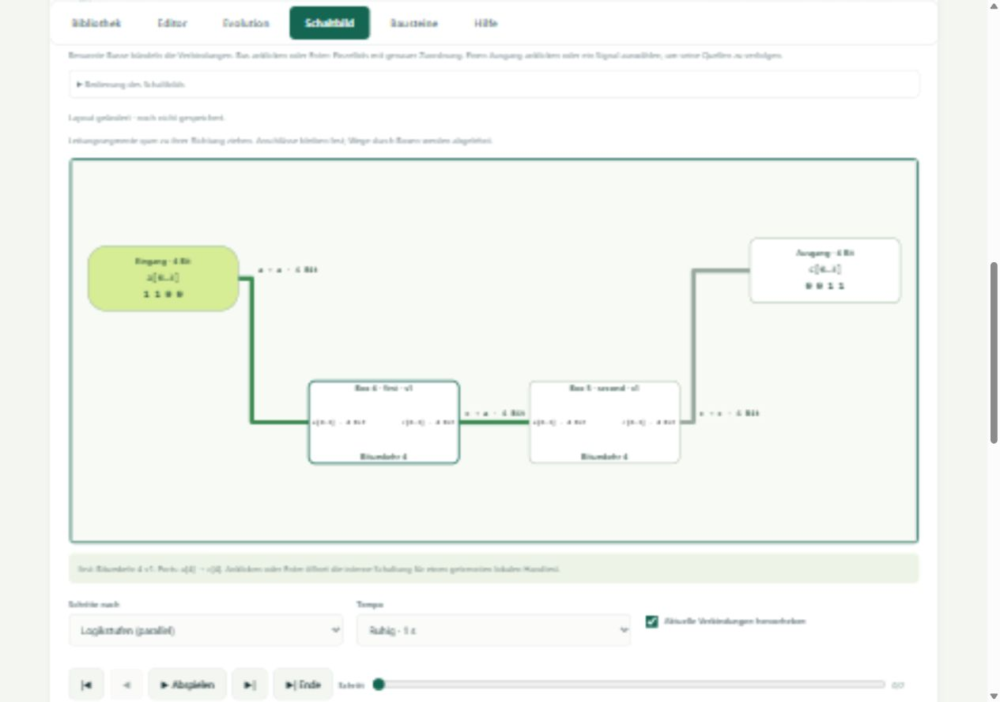

# Verdrahtungsübersicht: Busse, Unter-FBoxen und Signalverfolgung

PRIM-09, umgesetzt am 30. Oktober 2026. Nach dem Update den lokalen
Webserver neu starten und die Browserseite neu laden.

## Busse und Hierarchie

**Benannte Busse bündeln** zeigt mehrbitige Ein-/Ausgangsports als eine Box
und fasst Verbindungen zwischen denselben Quell- und Zielports zu einer
beschrifteten Busleitung zusammen. Beispielsweise werden vier Verbindungen
von `first.c` nach `second.a` zu `c → a · 4 Bit`.

Der Tooltip enthält jede wirkliche Zuordnung, beispielsweise
`c[3] → a[0]`, `c[2] → a[1]`, `c[1] → a[2]`, `c[0] → a[3]`.
Teilbereiche und mehrfach verwendete Quellbits bleiben einzeln dokumentiert.
Verbindungen aus verschiedenen Quellports bleiben getrennt. Einbitige
Verbindungen bleiben Einzelleitungen. Werte im Tooltip folgen der dort
aufgeführten Zuordnungsreihenfolge; Portwerte sind LSB-first.

**Klick oder Enter auf eine Busleitung oder gebündelte Portbox** schaltet
die gesamte aktuelle Ebene auf Einzelbits um. Mit der Checkbox lässt sie
sich wieder bündeln. In der Bitansicht bleiben die bisherigen einzelnen
Leitungswege bearbeitbar. Busse besitzen keine zusätzlichen gespeicherten
Leitungswege; ihre Darstellung ändert die vorhandenen Bitwege nicht.

**Klick oder Enter auf eine Unter-FBox** öffnet deren interne Schaltung.
Instanzpfad und **Zur übergeordneten Schaltung** führen über beliebig viele
vorhandene Ebenen bis zu den NANDs und zurück. Das setzt ausdrücklich
gespeicherte Hierarchien voraus. Flache evolutionäre Netze erhalten keine
automatisch erfundenen Funktionsblöcke.

## Signale untersuchen

**Signal verfolgen** bietet jeden Ausgang, Eingang und jedes interne
NAND-Signal an. Bei Hierarchien nennt die Auswahl die enthaltende FBox.
Auch ein einzelner Ausgang oder ein NAND lässt sich durch Klick oder Enter
zur Verfolgung auswählen. Gebündelte Ausgangsports zuerst aufklappen, um
ein bestimmtes Bit anzuklicken, oder es direkt in der Auswahl wählen.

Für einen Ausgang werden genau seine strukturellen Quellen und Verbindungen
hervorgehoben; andere Ausgänge bleiben abgeblendet, auch wenn sie dasselbe
Signal durchleiten. Interne Signale bieten zusätzlich **Quellen und abhängige
Ausgänge**. Dabei werden ihre Vorgänger sowie ihre nachfolgenden Gatter und
Ausgänge verfolgt. Weitere Eingänge dieser nachfolgenden Gatter gehören nicht
automatisch zu den Quellen des ausgewählten Signals.

Während der Signalverfolgung erscheinen automatisch Einzelbits, damit ein
teilweise betroffener Bus nicht vollständig hervorgehoben wird. Die Buscheckbox
ist dann vorübergehend deaktiviert. Nach **Zur Gesamtschaltung** gilt wieder
die zuvor gewählte Busdarstellung. Innerhalb einer geschlossenen Unter-FBox
markiert die Verfolgung deren Box und genau die benötigten eingehenden Pins;
zum Untersuchen ihrer NANDs die Box öffnen.

Die Abhängigkeit ist strukturell: Sie beschreibt die Verdrahtung, unabhängig
von der aktuellen Testeingabe, und behauptet keinen aktuellen Werteinfluss.

## Fokus und Rückkehr

**Nur Abhängigkeiten anzeigen** blendet unbeteiligte Boxen und Leitungen aus.
Die Auswahl und eine Statuszeile zeigen den aktiven Filter. Die Aktion
**Zur Gesamtschaltung** entfernt ihn und stellt die vor dem Fokus verwendete
Kamera wieder her. Andere Signale lassen sich auch bei aktivem Fokus wählen.
Eingangsänderungen und Animationsschritte behalten Auswahl, Filter und Kamera.

Positionen und manuelle Bitwege bleiben beim Filtern unverändert. Daher kann
ein fokussierter Teil eines sehr weit auseinandergezogenen Netzes weiterhin
grosse Abstände besitzen. Zoom, Verschieben und Einpassen bleiben verfügbar.
Beim Wechsel zwischen Unter-FBoxen sowie zwischen FBox- und flacher Ansicht
bleiben Filter, Busdarstellung, Kamera, Auswahl, Schritt und ungespeicherte
Layouts im Speicher erhalten. Wiederholtes Öffnen einer Unterinstanz übernimmt
erneut deren tatsächliche Elterneingänge für den lokalen Handtest.

Layouts werden weiterhin nur über **Layout speichern** dauerhaft gesichert.
Filter, Kameras und Navigationspfade werden nicht in Bibliotheksdefinitionen
oder NAND-Exporte geschrieben. Die logische Schaltung und ihre Simulation
bleiben unabhängig von diesen Ansichten.

## Umsetzung und Prüfung

`web/overview.js` projiziert Ports und Bitverbindungen auf Busse und berechnet
Vor-/Nachfolger anhand der wirklichen NAND-Expansion. Die ursprünglichen
Boxreferenzen und Bit-Leitungskennungen bleiben erhalten. Die lokale
Hierarchieprojektion aus `BlockBundle.view()` nennt unter `gateRefs` die
expandierten NANDs jeder sichtbaren Instanz; dadurch sind auch noch nicht
geöffnete interne Signale eindeutig zugeordnet. Diese Metadaten gehören nur
zur Ansicht und ändern keine feste Bausteindefinition.

Die Regressionstests prüfen insbesondere vertauschte und wiederholte Bits,
Teilbereiche, direkte Durchleitungen, Ausgangsaliase, gemeinsam genutzte
Signale, interne FBox-Signale, ein 512-Gatter-Netz und die Wiederherstellung
von Kamera und Layout. Einzelheiten und Prüfbefehle stehen in
[VERIFIKATION.md](VERIFIKATION.md#verdrahtungsübersicht-prim-09).

