# Verifikation des ersten Prototyps

## Bibliotheksbaum und strukturelle NAND-Synthese

Geprüft am 26. Oktober 2026: **194 Python-Tests** einschliesslich **27 HTTP-Tests**
mit lokalem Netzwerkzugriff und **29 JavaScript-Tests** erfolgreich.
`node --check web/app.js` und `git diff --check` bestehen ebenfalls.
Der erste Sandbox-Lauf scheiterte nur bei den 25 damaligen HTTP-Tests an
Windows-Socketfehler 10013; der vollständige freigegebene Lauf besteht.

Die vier neuen Templates und ihre tatsächlich übersetzten NAND-Netze wurden
für n=1,2,3,4 vollständig gegen unabhängige Ganzzahlarithmetik geprüft.
Grössere Referenzbreiten, Carry/Borrow, Division durch null, konstante Ausgänge,
Budgetabbruch, Gattergrenze und abgelehnte datenabhängige Steuerung sind abgedeckt.
Ordnerbeschreibungen und Zuordnungen überstehen das erneute Laden; zyklische
Teilbäume und das Löschen gefüllter Ordner werden abgewiesen. Wiederholte
Beispielinstallation erhält Benutzeränderungen und gelöschte Funktionen.

Im Browser geprüft: gemeinsame Suche, Template öffnen, Division für n=3 direkt
übersetzen (133 Gatter, alle 64 Eingaben korrekt), Ordner mit mehrzeiliger
Beschreibung anlegen, Unterordner erzeugen und ein Template hinein- sowie
zurückverschieben. [Ansicht des Bibliotheksbaums](bibliothek-baum.png).

Stand: 25. Oktober 2026. Geprüft mit Python 3.14.5 und der vorhandenen
TinyLanguage-Laufzeit unter Windows.

## Elternpopulation mit Turnierselektion (Etappe 2)

Geprüft am 25. Oktober 2026: **117 Kern-/CLI-/Suchtests** innerhalb der Sandbox
und **20 HTTP-Integrationstests** mit freigegebenem lokalem Netzwerkzugriff
erfolgreich, insgesamt **137 Python-Tests**. Ein HTTP-Test meldete beim ersten
freigegebenen Lauf einen Windows-Verbindungsabbruch (WinError 10053); der gezielte
Wiederholungslauf bestand. Ausserdem bestehen **22 JavaScript-Tests**,
`node --check web/app.js` und `git -c core.whitespace=cr-at-eol diff --check`.

- Neun neue Suchtests prüfen bewertete Initialisierung, einen Treffer im vierten
  Elternkandidaten, zwei unabhängige Turniere über die ganze Population,
  unveränderte Elterngenome, Abbruch und ein Zeitlimit während der Initialisierung.
- Python und die tatsächliche TinyLanguage-Laufzeit füllen Populationen von
  zwei bzw. fünf Mitgliedern auf einer mit dem Gatterbudget unlösbaren XOR-Aufgabe.
  Beide schöpfen das gemeinsame Bewertungsbudget ohne Überschreitung aus und
  liefern bei Wiederholung identische Schaltungen und Verbesserungsverläufe.
- Fünf Python-Seeds mit mehreren Ausgängen und weiterer Strukturoptimierung
  prüfen den monotonen besten Rang und vergleichen die Ergebnisfitness mit
  unabhängiger skalarer Schaltungsauswertung. Die bestehenden echten
  TinyLanguage-Läufe für XOR und verschachtelte Halbaddierer bleiben erfolgreich.
- Der HTTP-Suchtest liest die gespeicherten Auswahl-/Populationsmetadaten erneut
  aus der Bibliothek. Bestehende Hintergrundsuche, exakte Startlösung,
  Null-Zeitbudget, Retests, Bibliotheksbausteine und Abbruch beider Backends bestehen.

## Funktionen löschen

Geprüft am 25. Oktober 2026: **120 Python-Tests** mit
`python -m unittest discover -s tests` erfolgreich (für lokale HTTP-Verbindungen
ausserhalb der Sandbox). **18 JavaScript-Tests** mit `node --test tests/test_*.js`,
`node --check web/app.js` und `git diff --check` bestehen ebenfalls.

- Löschen entfernt sämtliche Stichproben/Vektorsätze und alle privaten
  Schaltungsversionen; erneutes Laden aus einer neuen Library-Instanz bestätigt
  die dauerhafte Entfernung. Unbekannte und ungültige Kennungen ändern keine Daten.
- Bei identischen Zuordnungsvektoren bleibt eine gemeinsam verwendete Schaltung
  samt älteren Versionen und Frozen-Einstellung der verbleibenden Funktion
  zugeordnet. Separat gespeicherte Unterprogramm-Bausteine bleiben lesbar.
- Der HTTP-Test startet einen echten Hintergrundprozess, löscht dessen Funktion
  und prüft, dass der Prozess beendet wird und keine Daten wieder angelegt werden.
  Fremde Browser-Ursprünge und das Löschen während eines manuellen Auftrags
  werden abgewiesen; nach dessen Abbruch ist Löschen möglich.
- Die JavaScript-Tests prüfen Bestätigen/Abbrechen, fehlgeschlagene Serveraufrufe,
  den Schutz laufender Aufträge und das Leeren einer betroffenen Ansicht samt
  deaktivierten Exporten. Eine andere geöffnete Funktion bleibt geladen.

## Kommentare und Bit-Arrays im Programmeditor

Geprüft am 25. Oktober 2026: **115 Python-Tests erfolgreich**
(99 Kern-/CLI-Tests innerhalb der Sandbox, 16 HTTP-Tests separat ausserhalb
der Sandbox, da sie lokale Socket-Verbindungen blockiert). Ausserdem bestehen
die **13 JavaScript-Tests**, `node --check web/app.js` und `git diff --check`.

- Kommentare in eigenen Zeilen und am Zeilenende bleiben im Quelltext erhalten
  und verbrauchen keine Ausführungsschritte.
- Bitumkehr über Arrayindizes wird für alle 16 Eingaben gegen eine unabhängige
  Referenz geprüft; die neue archivierte Beispielquelle samt Vektoren ist reproduzierbar.
- Literale, Wiederholungen, Verkettungen, Ausschnitte, Kopien/Referenzen,
  Einzelbit-Zuweisungen, `bits`, `pack`, `len`, negative Zahlen und mehrere
  Ergebnisports sind abgedeckt. Lokaler Arrayzustand bleibt je Eingabe unabhängig.
- Ungültige Bitwerte, Typen, Indizes, Breiten und Ausschnittschritte sowie
  übergrosse Arrays und Budgetüberschreitungen werden mit Quellort abgewiesen.
- Der HTTP-Test erzeugt die kommentierte Bitumkehr asynchron und prüft alle
  Vektoren sowie die unveränderte Quelle beim Import und erneuten Abruf.

## Unterprogramm-Boxen und Debugging (PRIM-06)

Aktueller Gesamtstand: **94 Python-Tests** mit
`python -m unittest discover -s tests` und **13 JavaScript-Tests** mit
`node --test tests/test_block_debug.js tests/test_graph.js tests/test_viewport.js`.
Die unten dokumentierten früheren Testzahlen gehören zu den jeweiligen Etappen.
Die HTTP-Integrationstests wurden ausserhalb der Sandbox ausgeführt, da deren
Netzwerkregeln lokale Loopback-Verbindungen blockieren.

`tests/test_block_debug.py` prüft für alle Eingaben der kleinen Addierer jede
sichtbare Quelle/Ziel-Pinzuordnung gegen die NAND-Signale und jede sichtbare
Instanz gegen eine eigene hierarchische Auswertung. Dazu kommen mehrbitige Ports,
mehrere Ausgänge, lokale NAND-Knoten, direkte und mehrfach verwendete Ausgänge,
ungültige Pfade und die unveränderten Definitionsinhalte.
Der HTTP-Test prüft Ansichtspfade bis zum Blatt, getrennte Instanzlayouts,
Leitungskennungen, Speicherung und erneutes Lesen mit einer neuen Library-Instanz.
Die JS-Prüfungen ergänzen 32-Bit-Zahleneingaben mit und ohne Vorzeichen,
Bereichsfehler, unveränderte Nachbarports, geordnete Bitpins, variable Boxhöhen
und Routing um hierarchische Boxen. Die bisherigen Routing-/Zoomtests bleiben gültig.

Im Browser mit isolierten Beispieldaten geprüft:

- Mehrbitige ADD-Box mit zwei Ausgängen: a=3, b=3, carryIn=1 ergibt sum=3,
  carryOut=1; lokale Nullwerte ergeben beide Ausgänge 0.
- Zurückkehren stellt die Elternwerte 3/3/1 und ihre tatsächlichen Ausgänge wieder her.
- Zwei Volladdierer-Instanzen derselben Definition bleiben nach lokalen Handtests unabhängig.
- Navigation per Klick und Enter über mehrere Ebenen bis zu den internen OR-NAND-Gattern.
- Reset auf 0/3, Einzelschritt auf 1/3 und vollständige Auswertung auf 3/3 mit
  erwarteten unbekannten bzw. bekannten Signalen; Zoom bleibt bei Schritten erhalten.
- Box per Tastatur verschoben, Instanzlayout gespeichert und nach Neuladen
  sowie erneuter Navigation zum selben Instanzpfad korrekt geladen.
- Schmale Ansicht ohne horizontalen Seitenüberlauf; Portwerte und Verdrahtung
  zusätzlich bei breiter Ansicht visuell geprüft.

Die Bedienansicht ist in [BAUSTEINE.md](BAUSTEINE.md#unterprogramm-boxen-und-lokales-debugging-prim-06)
abgebildet. Handwerte und Navigationspfad werden bewusst nicht dauerhaft gespeichert.

## Automatische Prüfungen

`python -m unittest discover -s tests -v`: **17 Tests erfolgreich**.

Die Tests prüfen widersprüchliche N:1- und N:M-Zuordnungen, Duplikate und
ungültige Bits, Zahlkodierung und mathematische Vorlagen, sichere Ausdrücke,
Sampling, NAND-Semantik, gemeinsame Teilbäume, ungültige Verweise, Kompaktierung,
die Übereinstimmung bitparalleler mit skalarer Fitness, Suchbudgets und Seeds,
Bibliothekskomposition, die Unterscheidung Stichprobe/vollständige Prüfung,
einen echten TinyLanguage-Suchlauf und den vollständigen HTTP-Weg bis zum
gespeicherten und erneut ausgewerteten Programm. Bei fehlender TinyLanguage-
Laufzeit wird der entsprechende Test ausdrücklich übersprungen.

`node --check web/app.js`: JavaScript-Syntaxprüfung erfolgreich.

## Zoom und Navigation (PRIM-01)

Geprüft am 25. Oktober 2026:

- `node --test tests/test_graph.js tests/test_viewport.js`: **7 Tests erfolgreich**.
  Neben dem bisherigen Routing prüfen sie Zoom um einen festen Mauspunkt,
  Zoomgrenzen, Verschieben bei verschiedenen Massstäben und vollständiges
  Einpassen breiter/hoher Schaltungen bei schmalen und breiten Ansichtsgrössen.
- `python -m unittest discover -s tests -p test_server.py -v`: **6 Tests erfolgreich**,
  einschliesslich Auslieferung von `viewport.js` und Layout-Persistenz. Die lokalen
  HTTP-Tests wurden ausserhalb der Sandbox ausgeführt, da diese Loopback-Verbindungen blockiert.
- `node --check web/app.js` und `node --check web/viewport.js`: erfolgreich.
- Browserprüfung auf einem temporären lokalen Server ohne Hintergrundsuche:
  Einpassen, 100 %, 125 %, Verschieben des Ausschnitts per Maus, Tastaturzoom,
  Boxziehen bei etwa 65 % und 125 %, Signalwechsel und Gatterschritte ohne
  Zurücksetzen der Ansicht sowie Speichern und erneutes Laden der Boxpositionen.
  Beim Ziehen um 35 Bildschirmpixel bei 125 % bewegte sich die Box korrekt um
  28 Schaltungskoordinaten; der Ausschnitt blieb unverändert.

Der Mausanker der Rad-Zoomfunktion ist durch die Geometrietests geprüft;
eine physische Touchpad-Zoomgeste wurde nicht manuell getestet.

## Manuelle Leitungswege (PRIM-02)

Geprüft am 25. Oktober 2026:

- `node --test tests/test_graph.js tests/test_viewport.js`: **11 Tests erfolgreich**.
  Neue Fälle prüfen Knicke in geraden Leitungen, feste Endpunkte, stabile logische
  Portkennungen, getrennte doppelte NAND-Eingänge, Anschlussanpassung bei
  Boxbewegungen, Hindernisse, temporäre automatische Führung und Wiederherstellung.
- `python -m unittest discover -s tests -v`: **46 Tests erfolgreich**, einschliesslich
  **7 HTTP-Tests**. Neue HTTP-Fälle prüfen Leitungswege nach einem tatsächlichen
  Serverneustart, Legacy-Layouts, getrennte Eingangskennungen und die Ablehnung
  ungültiger Wege ohne Überschreiben des zuvor gespeicherten Layouts.
  Wegen der Loopback-Sperre der Sandbox wurde die Python-Suite ausserhalb ausgeführt.
- `node --check web/app.js` und `git diff --check`: erfolgreich.
- Browserprüfung auf temporärem lokalem Server ohne Hintergrundsuche: gerade
  Leitung bei 125 % ziehen (60 Bildschirmpixel entsprechen 48 Schaltungseinheiten),
  per Tastatur weiter verschieben, Signal umschalten, speichern und erneut öffnen.
  Bei etwa 71 % wurde einer von zwei NAND-Eingangsdrähten derselben Quelle
  unabhängig verschoben (45 Pixel entsprechen rund 63,16 Einheiten). Anschliessend
  Box verschoben und Gatterschritte durchlaufen; manuelle Wege blieben erhalten.
  Entf sowie „Automatisch anordnen“ setzen die Wege zurück. Ein ungültiger Weg
  durch eine Box wird mit sichtbarer Meldung abgelehnt.

Maus und Tastatur wurden praktisch geprüft; Touch verwendet dieselben
Pointer-Ereignisse, wurde aber nicht an einem Touchgerät geprüft.

## Variable Bitbreiten (PRIM-03)

Geprüft am 25. Oktober 2026:

- `python -m unittest discover -s tests -v`: **56 Tests erfolgreich**, darunter
  **8 HTTP-Tests**. Die neun neuen Kern-/CLI-Tests vergleichen ADD/SUB/MUL
  unabhängig mit mathematischer Integer-Arithmetik: gleiche und ungleiche
  Operandbreiten, ADD(2,3,4), ADD(4,4,4), ADD(4,4,5), MUL(2,2,4), unsigned und
  Zweierkomplement, Abschneiden und Fehlerüberlauf sowie Carry/Borrow/Overflow.
  Auch eine positive Abschneidung bei SUB wird ausdrücklich von Borrow getrennt.
- Weitere neue Fälle prüfen Logik mit Wortbreiten, drei benannte Eingänge und
  zwei Ergebnisse, fortlaufende LSB-first-Zuordnung, ungültige Portnamen/Breiten/
  Offsets, widersprüchliche Operationsmetadaten und die bisherigen Grössenlimits.
  Die CLI wird als echter Unterprozess mit Operationsparametern sowie eigenen
  Port-/Ausdrucksdateien ausgeführt. Die bestehende TinyLanguage-Prüfung besteht.
- Referenzen für beliebige NAND-Schaltungen werden mit breiteren Ports, direkten
  Ausgängen und mehreren Ergebnissen geprüft; bei Ein-Bit-Ports entspricht die
  Auswertung der ursprünglichen Schaltung. Suche ohne vorhandene Implementierung,
  Metadaten nach Speichern/Laden und Erhalt einer neuen Portvariante trotz eines
  besseren bisherigen Bibliotheksprogramms sind ebenfalls geprüft.
- Die HTTP-Prüfung umfasst Operationskatalog, Variantenvorschau ohne Erzeugung,
  Generierung, Export-/Import-Roundtrip, erneutes Laden, ungültige Breiten,
  Überlauffehler und eine erfolgreiche Suche mit benannter Schnittstelle.
  Die gesamte Python-Suite lief wegen der Loopback-Sperre ausserhalb der Sandbox.
- `node --test tests/test_graph.js tests/test_viewport.js`: **11 Tests erfolgreich**.
  `node --check web/app.js` und `git diff --check`: erfolgreich.
- Browserprüfung auf temporärem lokalem Server mit einer Kopie der Beispieldaten
  und ohne Hintergrundsuche: ADD mit ungleichen Breiten und Carry erzeugen;
  Überlauf sichtbar ablehnen; signed mit Abschneiden ausführen; Operation in freie
  Ports umwandeln; gespeichertes XOR als 2/3/3-Breitenvariante erzeugen und suchen;
  nach Neuladen die gespeicherten Breiten wieder öffnen. Der kurze Suchlauf war
  eine korrekt ausgewiesene Annäherung und behauptet keine vollständige Lösung.
  Auch eine frei eingegebene NAND-Schaltung wurde als 2/3/3-Busreferenz mit 32
  vollständigen Vektoren ausgeführt. Der Screenshot zeigt die wieder geladenen
  Breiten und benannte Simulationsbits.

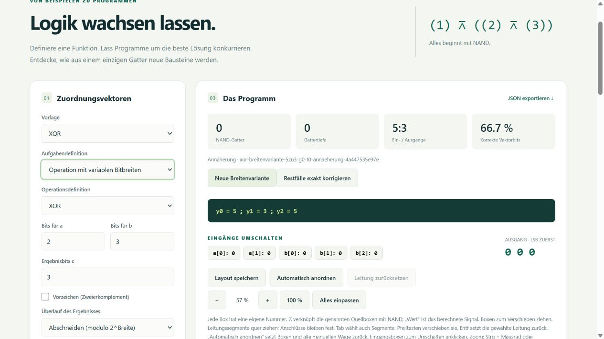

Die automatische Browserprüfung deckt keine physische Touchbedienung ab.

### Eigenständige Funktionsdefinitionen

Nach der Ergänzung der Funktionsübersicht am 25. Oktober 2026:

- Die vollständige Python-Suite besteht mit **58 Tests**, davon **9 HTTP-Tests**.
  Die neuen Fälle speichern ADD(1,1,2), ADD(4,4,5), ADD(8,8,9) und ADD(1,1,16)
  gleichzeitig ohne eine vorhandene Schaltung. Nach einem tatsächlichen
  HTTP-Serverneustart sind alle vier mit eigener Funktionskennung und korrekter
  Referenz abrufbar. Weitere Stichproben derselben Definition bleiben derselben
  Funktion zugeordnet und einzeln ladbar; signed ist eine separate Definition.
- **11 JavaScript-Tests**, Syntaxprüfung und `git diff --check` bestehen weiterhin.
- Im Browser auf einer leeren temporären Testbibliothek alle drei gewünschten
  ADD-Funktionen nacheinander gespeichert, nebeneinander angezeigt, Seite neu
  geladen und ADD(4,4,5) wieder geöffnet. Danach ADD(1,1,16) als vierte Funktion
  gespeichert. Namen, Bitbreiten, Tabellenstatus und fehlende Schaltungsimplementierung
  wurden korrekt angezeigt. ADD(8,8,9) ist mit 256 Vektoren als Stichprobe
  gespeichert und trotzdem als vollständige Referenzfunktion definiert.

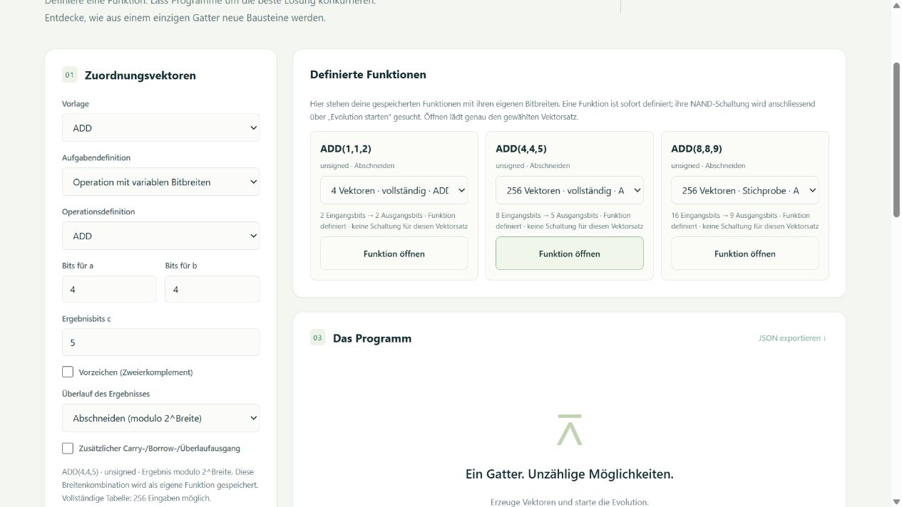

### Eigene arithmetische Formeln

Geprüft am 25. Oktober 2026 mit **66 erfolgreichen Python-Tests**,
darunter **10 HTTP-Tests**; ausserdem **11 JavaScript-Tests**, Syntaxprüfung
und `git diff --check` erfolgreich. Die Python-Suite lief für die HTTP-Tests
ausserhalb der Sandbox.

Die sieben neuen Kern-/CLI-Tests prüfen die vollständige 256-Zeilen-Tabelle
für `c=mod(a+b,2^4), e=div(a+b,2^4)` gegen unabhängige Integer-Arithmetik,
einfache Ausdrücke mit frei benanntem Ergebnis, Komma-/Zeilen-/Semikolonnotation,
Potenzpriorität und unverändertes historisches XOR, negative Division/Modulo,
Nullteiler und ungültige oder unzulässige Formeln. Metadaten-Roundtrip,
Bibliothek, tatsächliche CLI-Aufrufe mit Formeltext/Quelldatei und Übersetzung
zwischen den beiden Ausdruckssyntaxen werden ebenfalls geprüft. Der neue
HTTP-Test prüft Erzeugung, alle Sollwerte, Import/Laden und Fehlerantworten.

Browserprüfung auf leerer temporärer Testbibliothek: `a+b` als eigene Funktion
gespeichert, anschliessend das genaue Komma-Beispiel des Nutzers eingetippt,
die Ergebnisports übernommen, c auf 4 Bits eingestellt und mit e=1 Bit
gespeichert. Nach Neuladen liessen sich Quelle und Breiten unverändert öffnen.
Der Wechsel zum bisherigen Porteditor und das Öffnen der Standardoperation
XOR als `c = xor(a,b)` wurden ebenfalls praktisch geprüft.

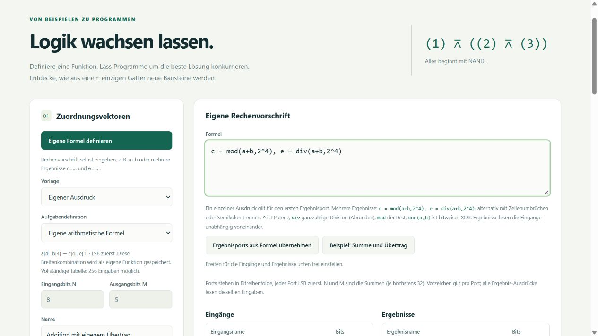

## TinyCPU-Operationen (PRIM-04)

Geprüft am 25. Oktober 2026:

- `python -m unittest discover -s tests -v`: **76 Tests erfolgreich**, darunter
  **11 HTTP-Integrationstests** und ein tatsächlicher TinyLanguage-Suchlauf.
  Die Suite lief mit Loopback-Zugriff ausserhalb der Sandbox; innerhalb der
  Sandbox verhindert WinError 10013 die HTTP-Verbindungen.
- Neun neue Kerntests prüfen DIV gegen unabhängige Ganzzahldivision bei signed,
  unsigned und ungleichen Breiten; Nullteiler, min_signed/−1, Abschneiden und
  Fehlerüberlauf. Prädikate, alle sechs Vergleiche, SHL/SHR/SAR, INC/DEC und MUX
  werden bei kleinen Breiten vollständig geprüft. Feste Schiebeweiten 0, 1,
  Wortbreite, darüber und 32 sowie ein variabler 31-Bit-Schiebeeingang sind enthalten.
- Weitere Fälle prüfen gezielte Randfälle in reproduzierbaren grossen Stichproben,
  ungültige Parameter, Port-/Gesamtlimits, alle 29 archivierten Referenztabellen,
  die acht vorhandenen NAND-Beispiele, tatsächliche CLI-Aufrufe und wiederholten
  Bibliotheksimport ohne Überschreiben vorhandener Dateien.
- Der neue HTTP-Test prüft Katalog, Variantenvorschau, Erzeugung und
  Export-/Import-Roundtrip von DIV, MUX, SAR mit n=32 und IsZero sowie ungültige
  Weiten und Ergebnisbreiten. Die vorhandene HTTP-Prüfung für Suche und
  Bibliothek bleibt erfolgreich.
- `python tools/verify_tinycpu.py ../TinyCPU`: **7424 erfolgreiche Vergleiche**
  gegen den tatsächlichen 16-Bit-Interpreter für ADD/SUB/MUL/DIV/AND/OR/XOR
  in allen vier Adressierungsarten und NOT. Die 1364 arithmetischen Überlauffälle
  prüfen Status und CPU-Ungültigkeit entsprechend der dokumentierten Abweichung.
  Commit und vollständiges Befehlsinventar stehen in [TINYCPU.md](TINYCPU.md).
- **11 JavaScript-Tests**, `node --check web/app.js` und `git diff --check`
  erfolgreich.
- Browserprüfung auf leerer temporärer Bibliothek ohne Hintergrundsuche:
  DIV mit signed Operanden und valid/div0 erzeugt; MUX mit zusätzlichem select
  erzeugt; SAR von variabler auf feste Weite umgeschaltet, n=32 gespeichert;
  Seite neu geladen und Funktion samt Schiebeparameter wieder geöffnet.
  IsNegative mit unsigned Ergebnisbit erzeugt. Namen, N/M, vollständige Tabellen
  und fehlende NAND-Implementierungen werden korrekt angezeigt; keine Konsolenfehler.

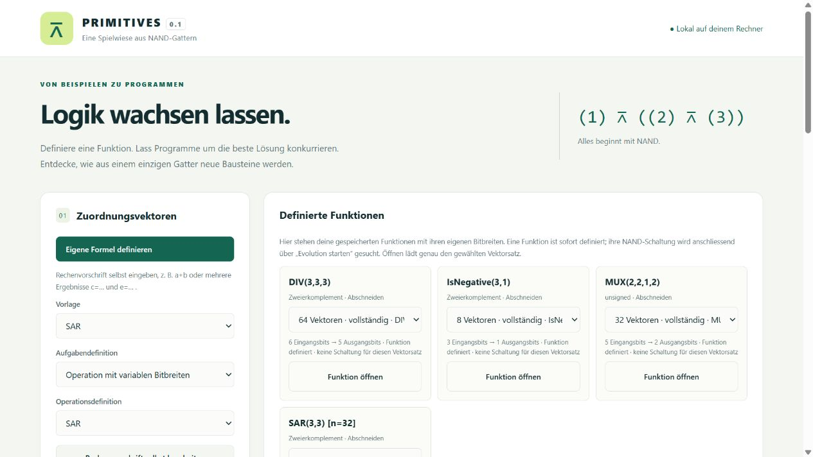

## Unterprogramm-Bausteine (PRIM-05)

Geprüft am 25. Oktober 2026:

- `python -m unittest discover -s tests -v`: **90 Tests erfolgreich**, darunter
  **12 HTTP-Tests**. Die Suite lief für die lokalen HTTP-Verbindungen ausserhalb
  der Sandbox. Beide tatsächlichen TinyLanguage-Suchtests bestanden ebenfalls.
- Die 13 neuen Kerntests vergleichen Halbaddierer, Volladdierer und Zweibit-Addierer
  auf allen 4/8/32 Eingaben mit unabhängiger Ganzzahlarithmetik sowie zwischen
  rekursiver Hierarchieauswertung und NAND-Expansion. Die tiefste Beispielkette ist
  Zweibit-Addierer → Volladdierer → Halbaddierer → XOR/AND.
- Ein weiterer Aufbau verbindet zwei Instanzen mit unterschiedlich breiten
  Ein-/Ausgangsports, vertauscht Bits, nutzt direkte Ausgänge und ein lokales NAND.
  Auch eine von der Knotenliste abweichende Auswertungsreihenfolge wird geprüft.
  Fehlerfälle umfassen fehlende Abhängigkeiten, direkte/indirekte Definitionsrekursion,
  Signalzyklen, unbekannte Ports/Knoten, doppelte Instanznamen, falsche Bitbreiten,
  ungültige Vektoren, manipulierte Inhaltskennungen und leere Schnittstellen.
- Die Limits für gesamte NAND-Expansion, Verschachtelungstiefe und expandierte
  gatterlose Hierarchien sind mit ablehnenden Tests geprüft. Speichern/Laden und
  Import in eine leere Bibliothek erhalten alle eingebetteten Definitionen ohne
  separate Abhängigkeitsdateien. Eine bessere Bibliotheksschaltung verändert
  einen vorher gespeicherten Baustein nicht. Neue Versionen bleiben nebeneinander.
- Programmexport und erneutes Einhüllen erhalten die Hierarchie. Nicht passende
  Hierarchie/NAND-Paare werden abgelehnt. Suchen mit Python und TinyLanguage
  verwenden gespeicherte verschachtelte Bausteine und finden für den Halbaddierer
  null Fehler. Die Ergebnisse beanspruchen keine erhaltenen Originalinstanzen.
  Eine tatsächliche Restfallkorrektur entfernt die geänderte Hierarchiebehauptung.
- Tatsächliche CLI-Aufrufe prüfen Import, Auflistung, Auswertung, Expansion,
  Vektorerzeugung und Zusammensetzung mit fester Abhängigkeit. Alle drei
  archivierten Beispielpakete werden gegen ihren reproduzierbaren Generator geprüft.
- Der neue HTTP-Test prüft Paketimport, Katalog, rekursive Auswertung, Expansion,
  Vektor-Roundtrip, Erzeugung eines weiteren Elternbausteins, Ablehnung ungültiger
  Verbindungen/fehlender Abhängigkeiten und Erhalt nach einem tatsächlichen Serverneustart.
- **11 JavaScript-Tests**, `node --check web/app.js` und `git diff --check` bestehen.
- Browser auf temporärer Bibliothek ohne Hintergrundsuche: Mehrstufigen
  Zweibit-Addierer geöffnet; zwei Halbaddierer über den JSON-Editor verbunden
  und gespeichert; die neue Hierarchie als Unterbaustein in einen weiteren
  Elternbaustein eingesetzt, Seite neu geladen und erneut geöffnet. Zusätzlich
  die geöffnete Hierarchie unter neuem Namen gespeichert. Der tatsächlich
  heruntergeladene Programmexport wurde mit `BlockBundle`, `Circuit` und `Dataset`
  gelesen: Hierarchie, Expansion, Vektoren und alle Abhängigkeiten stimmen überein.
  Der Wechsel zu einer flachen Schaltung blendet die bisherige Hierarchieliste aus.
  Die Konsole blieb ohne Warnungen/Fehler.

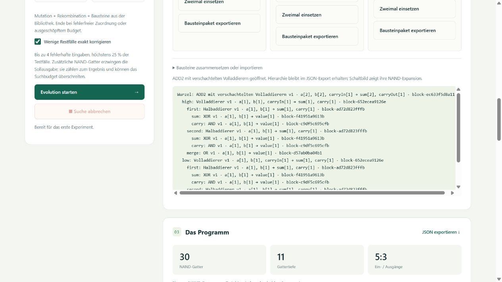

## Tatsächliche Suchergebnisse

Alle folgenden Programme wurden vom TinyLanguage-Backend gefunden und gegen
ihre vollständigen Wahrheitstabellen geprüft. Die Gatterzahlen beschreiben
die gefundenen Ergebnisse; sie behaupten keine Minimalität.

| Funktion | N:M | NAND-Gatter | Tiefe | Falsche Ausgangsbits |
|---|---:|---:|---:|---:|
| NOT | 1:1 | 1 | 1 | 0 |
| NAND | 2:1 | 1 | 1 | 0 |
| AND | 2:1 | 2 | 2 | 0 |
| OR | 2:1 | 4 | 3 | 0 |
| XOR | 2:1 | 4 | 3 | 0 |
| NOR | 2:1 | 8 | 6 | 0 |
| XNOR | 2:1 | 5 | 4 | 0 |
| Halbaddierer | 2:2 | 6 | 3 | 0 |

XOR ohne Startbibliothek: 8 Gatter Budget, 24 Nachkommen, 200 Generationen,
Seed 1. Gefunden nach 16 Generationen und 383 Bewertungen.

Halbaddierer mit den sieben zuvor gespeicherten Logikbausteinen: 12 Gatter
Budget, 24 Nachkommen, 1000 Generationen, Seed 1. Gefunden nach
204 Generationen und 4876 Bewertungen. Diese Angaben sind zusammen mit
den konkreten Schaltungen in `examples/library/` archiviert.

## Bedienprüfung

Im Browser geprüft: Vektoren erzeugen, TinyLanguage-Suche starten,
XOR-Ergebnis speichern und anzeigen, Eingangsbit umschalten, Ausgangsänderung
beobachten, schrittweise Gatteranimation abspielen sowie den N:M-Halbaddierer
aus der Bibliothek laden. Alle vier Halbaddierer-Zeilen werden korrekt angezeigt.

Zusätzlich wurden die Oracle-Kommandozeile und die vollständige Generierung
von 65536 Sinusvektoren mit 16 Eingangs- und 12 Ausgangsbits ausgeführt.
Damit wurde die **Vektorgenerierung**, nicht die Synthese einer vollständigen
Sinusschaltung nachgewiesen.

## Mehrschrittige Programme (PRIM-07)

Geprüft am 25. Oktober 2026:

- `python -m unittest discover -s tests -v`: **109 Tests erfolgreich**, darunter
  **15 HTTP-Integrationstests** und die bestehenden tatsächlichen TinyLanguage-Läufe.
  Die Suite lief wegen der Loopback-Sperre mit freigegebenen lokalen Verbindungen.
- 13 neue Kern-/CLI-Tests vergleichen for-/while-Summen, verschachtelte Verzweigungen,
  rückwärts laufende und verschachtelte Schleifen auf vollständigen kleinen Bereichen
  mit unabhängiger Integer-Arithmetik. Weitere Fälle prüfen null Durchläufe, einmalig
  ausgewertete range-Grenzen, mehrere Rückgabewerte, Zweierkomplement, Abschneiden,
  Fehlerüberlauf, negative Division, XOR/Potenz und Kurzschlussauswertung.
- Frischer lokaler Zustand je Aufruf, nicht initialisierte Variablen, fehlende
  Rückgabe, ungültige Syntax/Host-Zugriffe auch in unerreichbaren Zweigen sowie
  Sprachversion, Grössen-, Anweisungs-, Iterations- und Gesamtlimits werden geprüft.
  Laufzeitfehler enthalten Eingabe und Quellposition. Abbruch wird vor und während
  der tatsächlichen Auswertung ausgelöst.
- Die zwei neuen HTTP-Tests prüfen asynchrone und synchrone Erzeugung, sämtliche
  Sollwerte, Import/Export-Roundtrip, Erhalt nach Serverneustart, fehlerfreie
  bestehende NAND-Suche aus Programmvektoren sowie Abbruch und anschliessenden
  Neustart der Erzeugung. Fehler-/Abbruchaufträge speichern keine Teildatensätze.
- Tatsächliche CLI-Aufrufe erzeugen Vektoren aus einer UTF-8-Programmdatei und
  erhalten eine bestehende Ausgabedatei bei einem späteren Budgetfehler. Die drei
  archivierten Beispieldatensätze samt Quellen werden gegen ihre Erzeugung geprüft.
- **13 JavaScript-Tests**, `node --check web/app.js` und `git diff --check` bestehen.
- Browserprüfung mit separater temporärer Bibliothek ohne Hintergrundsuche:
  for-, while- und if/else-Beispiele gespeichert; Quelltext und Ports nach Neuladen
  wieder geöffnet; Überlauf sichtbar abgelehnt; laufende Vektorerzeugung abgebrochen.
  Danach blieb ausschliesslich die vorher gespeicherte Funktion erhalten. Alle drei
  Beispiele stehen nach weiterer erfolgreicher Erzeugung nebeneinander. Die
  Browserkonsole meldete keine Warnungen/Fehler. Die schmale Ansicht wurde visuell
  geprüft; physische Touchbedienung wurde nicht getestet.

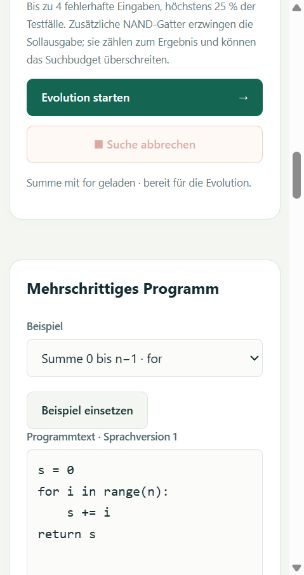

## Labels, Sprünge und Ablaufdebugger (PRIM-08)

Geprüft am 25. Oktober 2026:

- `python -m unittest discover -s tests -v`: **128 Tests erfolgreich**, darunter
  **20 HTTP-Integrationstests** und tatsächliche TinyLanguage-Läufe. Die Sandbox
  sperrt Loopback-Verbindungen (WinError 10013); der erfolgreiche Gesamtlauf
  erfolgte mit freigegebenen lokalen Verbindungen.
- Sechs neue Kernprüfungen vergleichen Vorwärts-/Rückwärtssprünge und beide Pfade
  aller vier Bedingungen auf allen 16 Eingaben mit unabhängiger Arithmetik.
  Direkte Ausführung, Einzelschritte und 100er-Abschnitte liefern bei Sprüngen,
  strukturierten Kontrollen und Arrays identische Ergebnisse und Budgetzähler.
- Unbekannte/doppelte/dynamische Ziele, ungültige Syntax, nicht erlaubte
  Blockeintritte, übersprungene Initialisierungen, For-Neustart, Ausgabeüberlauf,
  ungültige Testeingaben, alle drei Budgets und Abbruch werden geprüft.
  Reset stellt Variablen, Arrays und Zähler exakt wieder her; alte Snapshots
  werden durch spätere Arrayänderungen nicht rückwirkend verändert.
- Zwei neue HTTP-Tests prüfen Start, Schritt, Fortsetzen, Stoppen, Reset und
  Schliessen, unabhängige Sitzungen, die Grenze von 100 Anweisungen pro Aufruf,
  begrenzte Endlosschleifen und das Verdrängen alter Sitzungen beim 33. Start.
  Debuggen speichert keine Datensätze. Beide neuen Beispieldateien samt Quellen
  werden im bestehenden Archiv-/CLI-Test reproduziert.
- `node --test tests/test_*.js`: **22 Tests erfolgreich**. Vier neue UI-Tests
  prüfen die übernommene Quelle beim Reset, Endergebnis und Bedienzustände,
  Stoppen während einer ausstehenden Anfrage, Netzwerkfehler und literale
  Quelltextdarstellung. `node --check web/app.js` und
  `git -c core.whitespace=cr-at-eol diff --check` bestehen (TinyCPU-Dokument mit CRLF).
- Browserprüfung mit temporärer Bibliothek und deaktivierter Hintergrundsuche:
  Sprungsumme bei n=5 liefert 10, Einzelschritt ändert PC und Variablen korrekt,
  Reset stellt PC 0 und leere lokale Variablen wieder her. Eine laufende
  Rücksprungschleife lässt sich stoppen und bei kleinerem Budget begrenzt beenden.
  Ein fehlendes Label erscheint vor Ausführungsbeginn als Fehler. Zero-Auswahl
  liefert bei n=0 den Wert 42 und bei n=5 den Wert 5. Alle 16 Vektoren wurden
  gespeichert; Neuladen und Wiederöffnen erhalten die Quelle. Die Desktopansicht
  wurde visuell geprüft; physische Touchbedienung wurde nicht getestet.

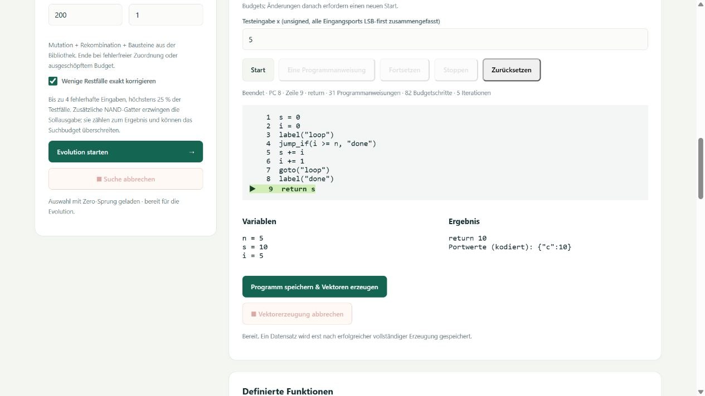

## Funktionsbeschriftung, Seitenaufteilung und integrierte Hilfe

- `python -m unittest discover -s tests`: **140 Tests erfolgreich**.
  Neue Bibliotheks- und HTTP-Tests prüfen Namen und mehrzeilige Beschreibungen,
  gemeinsame Beschriftung mehrerer Vektorsätze, Neustart, Export/Import,
  unveränderte Kennungen und historische Schaltungen, Hintergrund-Retests,
  Textgrenzen, leere Beschreibungen und das Entfernen verwaister Beschriftungen.
- `node --test tests/test_*.js`: **22 Tests erfolgreich**;
  `node --check web/app.js` und `git diff --check` bestehen.
- Browserprüfung mit getrennter Testbibliothek und deaktivierter Hintergrundsuche:
  XOR mit Beschreibung gespeichert, umbenannt, nach Server- und Browserneustart
  wiedergefunden und über Name bzw. Beschreibung gefiltert. Ein Suchlauf liefert
  eine vollständig geprüfte Schaltung; „Schaltung ansehen“ lädt sie mit Vektoren.
  Metadaten- und Formelentwürfe bleiben beim Wechsel zur Hilfe und zurück erhalten.
  Hilfethemen sind direkt verlinkbar; die Browserkonsole meldet keine Fehler.
- Desktopansicht bei 1280 Pixeln und schmale Hilfeansicht bei 375 Pixeln visuell
  geprüft; auf der schmalen Ansicht kein horizontaler Seitenüberlauf.
  Physische Touchbedienung wurde nicht geprüft.

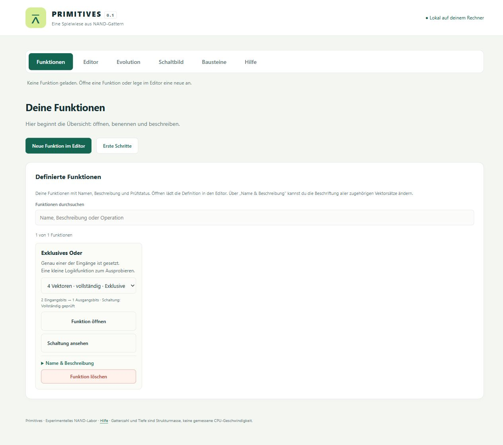

## Unabhängige Starts, Inselpopulationen und Diversität

Geprüft am 25. Oktober 2026:

- `python -m unittest discover -s tests`: **150 Tests erfolgreich**, darunter
  **22 HTTP-Integrationstests** und tatsächliche TinyLanguage-Läufe. Unter Windows
  mit `PYTHONUTF8=1` für einheitliche Kodierung der CLI-Unterprozesse; wegen
  WinError 10013 mit freigegebenen lokalen HTTP-Verbindungen ausgeführt.
- Die erweiterten Suchtests prüfen beide Backends mit drei unabhängigen Starts
  und drei ungleich grossen Inseln (3/2/2 Eltern). Eine mit einem NAND unmögliche
  XOR-Aufgabe verbraucht genau 64 Bewertungen, verteilt als 21/21/22. Wiederholte
  Läufe liefern dieselbe Schaltung, Historie, Migrationen und Diversitätswerte.
  Seedüberlauf von 2^31−1 auf 0 und die unabhängig nachbewertete Fitness sind geprüft.
- Weitere Fälle prüfen frische Populationen ohne Übernahme des vorherigen Gewinners,
  Erhalt des besten Gesamtergebnisses, simultane Ringmigration ohne Kaskaden oder
  verschlechterte Zielmitglieder, unveränderte Quellgenome, frühzeitige Fehlerfreiheit
  mit ungefüllten Inseln sowie Optimierung trotz Fehlerfreiheit. Zeitlimit während
  der Initialisierung und Abbruch zwischen Starts sind enthalten.
- Die mittlere normalisierte Gendifferenz wird mit einer unabhängigen paarweisen
  Berechnung verglichen; leere Populationen, Einzelgenome und identische Genome
  liefern 0. Ungültige Typen, Wertebereiche, zu kleine Inseln und unzureichende
  Initialisierungsbudgets werden abgelehnt. Tatsächlicher CLI-Aufruf und HTTP-Suche
  erhalten die neuen Parameter und die Suchmetadaten nach Speichern/Laden.
- `node --test tests/test_*.js`: **22 Tests erfolgreich**;
  `node --check web/app.js` und `git diff --check` erfolgreich.
- Browserprüfung auf separater temporärer Bibliothek ohne Hintergrundsuche:
  TinyLanguage mit drei Starts, drei Inseln und Austausch in jeder Generation
  ausgeführt. 64 Kandidaten und die Diversität der letzten Population werden
  angezeigt; XOR mit einem NAND bleibt korrekt als Annäherung ausgewiesen.
  Vier Inseln bei sieben Eltern werden sichtbar abgelehnt; die Suchschaltfläche
  ist danach wieder bedienbar. Neuladen und erneutes Öffnen erhalten die Statistik.
  Die schmale Ansicht zeigt keinen horizontalen Seitenüberlauf. Beim erfolgreichen
  Lauf und Wiederöffnen wurden keine JavaScript-Warnungen oder -Fehler beobachtet.
  Physische Touchbedienung wurde nicht geprüft.

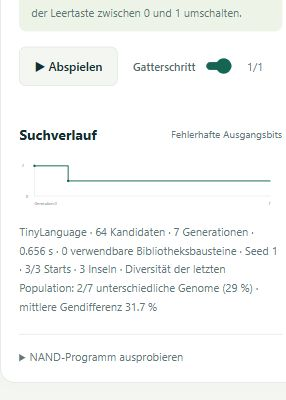

## Neutrale Evolution und getrennte Vereinfachung

Geprüft am 25. Oktober 2026:

- `python -m unittest discover -s tests`: **162 Tests erfolgreich**, darunter
  **23 HTTP-Integrationstests** und tatsächliche TinyLanguage-Läufe. Unter Windows
  mit `PYTHONUTF8=1`; nach der bekannten WinError-10013-Loopback-Sperre wurde die
  vollständige Suite mit freigegebenen lokalen Verbindungen erfolgreich ausgeführt.
- Elf neue Kerntests prüfen neutralen Rang unabhängig von Gatterzahl und Tiefe,
  Aufnahme grösserer gleich guter Nachkommen, Erhalt des gesicherten Eliten und
  strikte boolesche Konfiguration. Beide Backends prüfen frühe Fehlerfreiheit,
  getrennte Phasen, gespeicherte Metadaten sowie drei Starts mit drei Inseln,
  Ringmigration und exakt 64 Bewertungen. Wiederholungen erhalten Ergebnisse,
  Phasen, Historie und Diversität. Ein tatsächlicher CLI-Aufruf prüft `--neutral`.
- Die Vereinfachung wird auf **160 zufälligen Schaltungen mit 1–4 Eingängen**
  gegen alle Eingaben unabhängig skalar geprüft. Weitere Fälle prüfen vertauschte
  NAND-Eingänge, doppelte Negationen, gemeinsam verwendete Inverter, mehrere und
  direkte Ausgänge, tote Gatter, gatterlose Ergebnisse und 32 Eingänge. Gatterzahl
  und Tiefe nehmen nicht zu; ein weiterer Durchlauf verändert das Ergebnis nicht.
- Ein Stichprobentest prüft den Funktionserhalt auch auf nicht enthaltenen
  Eingaben, ohne den Prüfstatus aufzuwerten. Zeitlimit, Abbruch während des
  Umschreibens und Abbruch am Phasenübergang werden geprüft. Die strukturelle
  Vereinfachung erhöht das Kandidatenbudget nicht und beansprucht keine Minimalität.
- Ein neuer HTTP-Test prüft Suche mit neutralem Modus und aktivierter Restfalloption,
  Phasenprotokoll, tatsächliche Reduktion von drei auf ein Gatter, unabhängige
  Nachbewertung, Wiederöffnen des gespeicherten Ergebnisses und ungültige Konfiguration.
- `node --test tests/test_*.js`: **24 Tests erfolgreich**. Zwei neue UI-Tests
  prüfen alte Ergebnisse ohne Phasen und die separate Phasenanzeige mit Gatterzahl,
  Tiefe und Hinweis auf anschliessende Restfallkorrektur. `node --check web/app.js`
  und `git diff --check` erfolgreich.
- Browserprüfung mit temporärer Bibliothek und deaktivierter Hintergrundsuche:
  neutralen Modus für TinyLanguage eingeschaltet, redundanten NAND mit drei
  Gattern als Ausgangspunkt verwendet. Das Ergebnis zeigt ein NAND, Tiefe eins
  und alle vier korrekten Sollwerte; das Phasenprotokoll weist **3 → 1 Gatter**
  und **Tiefe 3 → 1** getrennt aus. Neuladen und erneutes Öffnen erhalten die
  Anzeige. Die Desktopansicht wurde visuell geprüft; keine Browserwarnungen oder
  JavaScript-Fehler beobachtet. Physische Touchbedienung wurde nicht getestet.

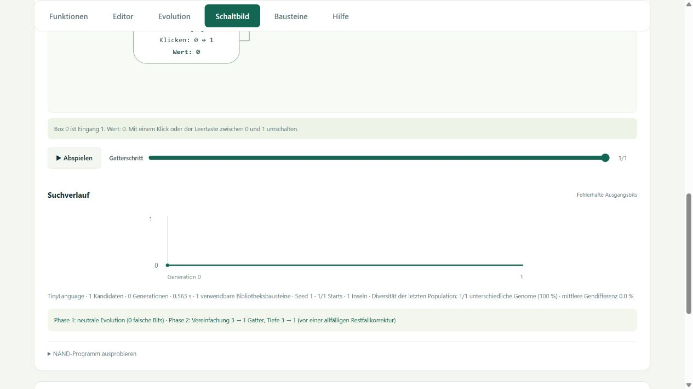

## Tatsächliche Kandidatenabstammung (Etappe 2)

Geprüft am 25. Oktober 2026:

- `PYTHONUTF8=1 python -m unittest discover -s tests`: **172 Tests erfolgreich**,
  einschliesslich **23 HTTP-Integrationstests** und echter TinyLanguage-Läufe.
  Der erste Sandboxlauf traf die bekannte WinError-10013-Loopback-Sperre;
  ausserdem benötigen CLI-Unterprozesse den vererbten UTF-8-Modus. Der vollständige
  Wiederholungslauf mit freigegebenen lokalen Verbindungen besteht.
- Zehn neue Abstammungstests rekonstruieren gespeicherte Genome aus tatsächlichen
  Eltern und Genänderungen. Alle exportierten Kandidaten werden unabhängig skalar
  gegen die Vektoren geprüft und ihre Ränge mit den gespeicherten Rängen verglichen.
  Kontrollierte Rekombination und Mutation prüfen die exakten übernommenen und
  mutierten Genpositionen; identische Genome behalten eigene Individuenkennungen.
- Python und TinyLanguage erzeugen reproduzierbare Vorfahrengraphen mit echten
  Nachkommen und angenommenen Migrationen. Simultane Ringmigration kopiert die
  ursprünglichen Kandidatenkennungen statt bereits ersetzter Ziele. Drei Neustarts
  mit drei Inseln schöpfen gemeinsam exakt 31 Bewertungen aus, ohne laufinterne
  Elternbeziehungen über Neustartgrenzen zu erzeugen.
- Konkrete Programm- und Bausteinquellen werden mit Quellenverdrahtung und
  NAND-Schnappschüssen gegen die tatsächlich eingesetzten Gene geprüft.
  Ein wegen seiner Eingangsbreite ungeeigneter angebotener Eintrag erscheint
  nicht als Vorfahr. Die bisherige Lösung, neutrale Vereinfachung, explizite
  Auswahl einer besseren bisherigen Korrekturbasis und Restfallkorrektur bleiben
  getrennt nachvollziehbar. Nachbearbeitung verändert das Ausgangsprotokoll nicht.
- Tatsächlicher CLI-Aufruf, Bibliothek neu öffnen, HTTP-Speicherung und ein
  abgelehnter Retest prüfen den Erhalt der korrekten Genealogie. Die bisherige
  Suite prüft weiterhin Abbruch, Zeitlimit, frühe Fehlerfreiheit und Suchbudgets.
- `node --test tests/test_*.js`: **26 Tests erfolgreich**. Die Anzeige funktioniert
  auch bei alten Ergebnissen ohne Abstammung, zeigt Eltern und Nachbearbeitung,
  behandelt Quellennamen als Text und begrenzt grosse Graphen auf 100 Tabellenzeilen.
  `node --check web/app.js` und `git diff --check` bestehen.
- Browserprüfung mit temporärer Bibliothek und deaktivierter Hintergrundsuche:
  ein tatsächliches TinyLanguage-Ergebnis mit sechs Vorfahren einschliesslich
  Rekombination und Mutation geöffnet; nach Neuladen erneut aus der Bibliothek
  geöffnet. Kennungen und Elternbeziehungen bleiben erhalten. Die breite und
  schmale Ansicht wurden visuell geprüft, Tabelleninhalt bleibt innerhalb der
  scrollbaren Ansicht. Keine Browserwarnungen oder JavaScript-Fehler beobachtet.

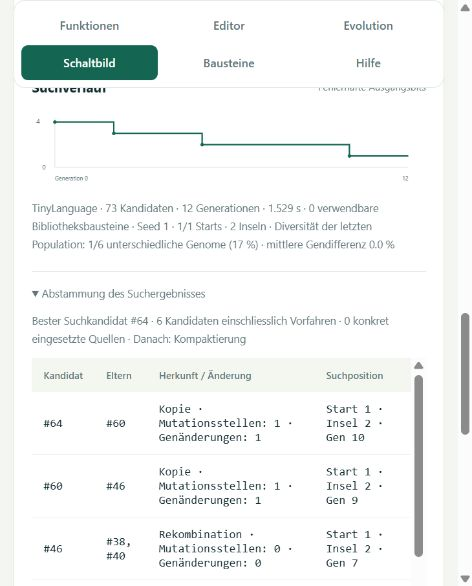
